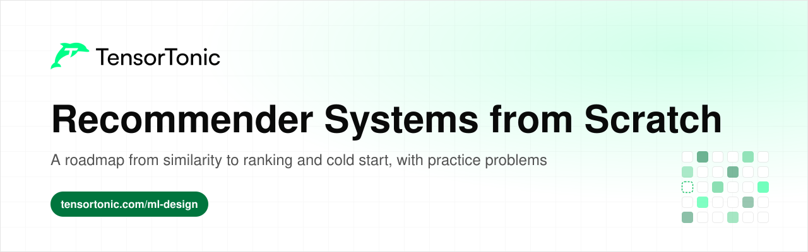
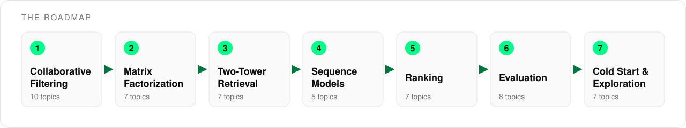

# Recommender Systems from Scratch

  

This is a roadmap for learning how recommender systems work by building each piece yourself. It covers 51 topics across seven stages, from measuring similarity between users and items to ranking, evaluation and cold start.

Every topic links to a short explanation and to practice problems where you implement the idea in Python and check your code against tests. Most real systems are a funnel where a fast retrieval stage picks a few hundred candidates and a slower ranking model orders them, and the stages here follow that funnel.

## Table of Contents

- [Who this is for](#who-this-is-for)
- [How to use this roadmap](#how-to-use-this-roadmap)
- [Stage 1: Collaborative Filtering](#stage-1-collaborative-filtering)
- [Stage 2: Matrix Factorization](#stage-2-matrix-factorization)
- [Stage 3: Two-Tower Retrieval](#stage-3-two-tower-retrieval)
- [Stage 4: Sequence Models](#stage-4-sequence-models)
- [Stage 5: Ranking](#stage-5-ranking)
- [Stage 6: Evaluation](#stage-6-evaluation)
- [Stage 7: Cold Start and Exploration](#stage-7-cold-start-and-exploration)
- [What's next](#whats-next)

## Who this is for

This roadmap is for anyone who wants to know what happens between a user opening an app and a ranked list of items showing up.

- If you are a **student**, go through the stages in order and do at least one problem per topic.
- If you are **preparing for interviews**, the retrieval, ranking and evaluation stages cover most of the recommendation questions that come up in ML system design rounds.
- If you already **work in ML**, use the tables as a checklist and implement the pieces you have only used through a library.

You need basic Python and comfort with vectors and dot products. The math behind each method is linked from the topic where it first appears.

## How to use this roadmap

The stages build on each other. Collaborative filtering introduces the user-item rating matrix, matrix factorization compresses it into embeddings, and the two-tower and sequence stages learn those embeddings with neural networks. Ranking, evaluation and cold start then sit on top of whatever retrieval method you use.

For each topic, read the explanation first, then solve one or two of the practice problems. Topics without a practice link are design ideas that are easier to read about than to code in isolation, and the later stages refer back to them.

## Stage 1: Collaborative Filtering

Collaborative filtering recommends items that similar users liked, using nothing but the rating matrix. This stage covers how to measure similarity, how to clean up sparse ratings, and how to predict a missing rating from a user's neighbours. The popularity and bias baselines are worth building first because every later model has to beat them.

| Topic | Read | Practice |
| --- | --- | --- |
| Dot product and cosine similarity | [What is the dot product?](https://www.tensortonic.com/ml-math/linear-algebra/dot-norm) | [Dot Product](https://www.tensortonic.com/problems/dot-product), [Cosine Similarity](https://www.tensortonic.com/problems/cosine-similarity) |
| Jaccard similarity | | [Jaccard Similarity](https://www.tensortonic.com/problems/jaccard-similarity) |
| Nearest neighbours | | [KNN Distance + Neighbor Lookup](https://www.tensortonic.com/problems/knn-distance) |
| Missing ratings | | [Mean Rating Imputation](https://www.tensortonic.com/problems/mean-rating-imputation) |
| Rating normalization | | [Rating Normalization](https://www.tensortonic.com/problems/rating-normalization) |
| Popularity baseline | [Building a baseline](https://www.tensortonic.com/ml-design/baselines) | [Popularity Ranking](https://www.tensortonic.com/problems/popularity-ranking) |
| User and item bias baseline | | [Baseline Predictor](https://www.tensortonic.com/problems/baseline-predictor) |
| User-based collaborative filtering | | [User-Based CF Prediction](https://www.tensortonic.com/problems/user-based-cf-prediction) |
| Item-based collaborative filtering | | [Item-Based CF Prediction](https://www.tensortonic.com/problems/item-cf-predict), [Adjusted Cosine Similarity](https://www.tensortonic.com/problems/adjusted-cosine-similarity) |
| Top-K recommendations | | [Top-K Recommendations](https://www.tensortonic.com/problems/top-k-recommendations) |

## Stage 2: Matrix Factorization

Neighbour methods get slow and noisy when the rating matrix is huge and mostly empty. Matrix factorization learns a short vector for every user and every item so that their dot product approximates the rating. This stage covers the linear algebra behind it and the two usual ways to fit it, alternating least squares and gradient descent.

| Topic | Read | Practice |
| --- | --- | --- |
| Singular value decomposition | [What is SVD?](https://www.tensortonic.com/ml-math/linear-algebra/svd) | [SVD Components](https://www.tensortonic.com/problems/la-svd-components) |
| Low-rank approximation | | [Low-Rank Approximation](https://www.tensortonic.com/problems/la-low-rank-approx) |
| Alternating least squares | [What is least squares?](https://www.tensortonic.com/ml-math/linear-algebra/projections-least-squares) | [Least Squares Solution](https://www.tensortonic.com/problems/la-least-squares) |
| Factorization with SGD | [Batch vs mini-batch vs SGD](https://www.tensortonic.com/ml-math/optimization/sgd-variants) | [Matrix Factorization SGD Step](https://www.tensortonic.com/problems/matrix-factorization-sgd-step) |
| Loss and optimizer | [Adam vs RMSprop vs AdaGrad](https://www.tensortonic.com/ml-math/optimization/adaptive-rates) | [Mean Squared Error (MSE)](https://www.tensortonic.com/problems/mean-squared-error), [Adam Optimizer Step](https://www.tensortonic.com/problems/adam-optimizer) |
| Regularization | [L1 vs L2](https://www.tensortonic.com/ml-math/optimization/regularization) | [AdamW (Decoupled Weight Decay)](https://www.tensortonic.com/problems/adamw-optimizer) |
| Item embeddings from co-occurrence | [Word2Vec negative sampling loss](https://www.tensortonic.com/research/word2vec/word2vec-sgns-loss) | [Word2Vec](https://www.tensortonic.com/problems/nlp-word2vec) |

## Stage 3: Two-Tower Retrieval

A two-tower model has one network that turns a user into a vector and another that turns an item into a vector, and retrieval becomes a nearest neighbour search between them. Most logged data only says what people chose, so the towers are trained contrastively, with the chosen item as the positive and other items in the batch as negatives. This is the retrieval stage of most large recommenders.

| Topic | Read | Practice |
| --- | --- | --- |
| Embeddings and similarity search | [Embeddings and similarity search](https://www.tensortonic.com/ml-design/embeddings) | [Cosine Embedding Loss](https://www.tensortonic.com/problems/cosine-embedding-loss) |
| Contrastive training with in-batch negatives | | [InfoNCE Loss](https://www.tensortonic.com/problems/info-nce-loss), [Symmetric CLIP Contrastive Loss](https://www.tensortonic.com/problems/cs336-l17-symmetric-clip-loss) |
| Pairwise and triplet losses | | [Contrastive Loss (Siamese)](https://www.tensortonic.com/problems/contrastive-loss), [Triplet Loss](https://www.tensortonic.com/problems/triplet-loss) |
| Softmax over candidates | | [Numerically Stable Softmax](https://www.tensortonic.com/problems/softmax-function) |
| Negative sampling and calibration | [Rare events and class imbalance](https://www.tensortonic.com/ml-design/sampling) | [Recalibrate Probabilities After Negative Downsampling](https://www.tensortonic.com/problems/recalibrate-after-downsampling) |
| Retrieval and ranking pipelines | [Retrieval and ranking pipelines](https://www.tensortonic.com/ml-design/retrieval-ranking), [Recommendation and Ranking projects](https://www.tensortonic.com/projects/sheets/recommendation-ranking) | |
| A full video recommendation design | [Video recommendation system design](https://www.tensortonic.com/ml-design/video-recommendation) | |

## Stage 4: Sequence Models

What a user watched in the last ten minutes often says more than their whole history. Sequence models read the history in order and predict the next item, first with recurrent cells and then with attention. The pieces are the same ones used in language models, applied to item IDs instead of words.

| Topic | Read | Practice |
| --- | --- | --- |
| Recurrent models | [GRU cell](https://www.tensortonic.com/research/gru/gru-cell) | [RNN Step Forward (Tanh Cell)](https://www.tensortonic.com/problems/rnn-step-forward), [Build a Mini GRU Cell (Forward Pass)](https://www.tensortonic.com/problems/gru-cell-forward) |
| Attention over history | [Attention in LLMs: Queries, Keys and Values Explained](https://www.tensortonic.com/llm-internals/attention-mechanism) | [Scaled Dot-Product Attention](https://www.tensortonic.com/problems/dl-scaled-dot-product-attention) |
| Position information | [Transformer positional encoding](https://www.tensortonic.com/research/transformer/transformers-positional-encoding) | [Sinusoidal Positional Encoding](https://www.tensortonic.com/problems/positional-encoding) |
| Causal masking for next-item prediction | | [Causal Masking for Attention](https://www.tensortonic.com/problems/causal-masking) |
| Transformer encoder block | [Transformer encoder block](https://www.tensortonic.com/research/transformer/transformers-encoder-block) | [Transformer Encoder Block](https://www.tensortonic.com/problems/dl-encoder-block) |

## Stage 5: Ranking

The ranker scores a few hundred candidates with a much richer model than retrieval can afford. It is usually a click or watch prediction model trained on logged impressions, so this stage covers features, logging, calibrated probabilities and learning from pairs of items where one was chosen over the other.

| Topic | Read | Practice |
| --- | --- | --- |
| Ranking features | [Choosing features](https://www.tensortonic.com/ml-design/features) | [Point-in-Time Feature Join](https://www.tensortonic.com/problems/point-in-time-feature-join) |
| Logging impressions | [Logging training examples](https://www.tensortonic.com/ml-design/logging) | |
| Click prediction | | [Logistic Regression Training Loop](https://www.tensortonic.com/problems/logistic-regression-training), [Binary Log Loss per Sample](https://www.tensortonic.com/problems/log-loss-per-sample) |
| Calibrated probabilities | | [Expected Calibration Error](https://www.tensortonic.com/problems/expected-calibration-error), [Isotonic Regression Calibration](https://www.tensortonic.com/problems/isotonic-calibration) |
| Tree-based rankers | | [Decision Tree Best Split](https://www.tensortonic.com/problems/decision-tree-split) |
| Learning from pairwise preferences | | [Fit Elo Ratings from Pairwise Votes](https://www.tensortonic.com/problems/cs336-l12-pairwise-elo-fit), [Canonicalize Pairwise Preference Data](https://www.tensortonic.com/problems/cs336-l15-canonical-preference-pairs) |
| Ranking a feed | [News feed ranking system design](https://www.tensortonic.com/ml-design/personalized-news-feed) | |

## Stage 6: Evaluation

Offline evaluation hides part of each user's history, recommends, and checks whether the hidden items land near the top of the list. Ranking metrics reward getting the top positions right, and coverage and novelty catch a model that only recommends popular items. An online A/B test is the final check, so this stage ends with the statistics needed to read one.

| Topic | Read | Practice |
| --- | --- | --- |
| Precision, recall and hit rate at K | [Retrieval and ranking metrics](https://www.tensortonic.com/ml-design/ranking-metrics) | [Precision and Recall at K](https://www.tensortonic.com/problems/precision-recall-at-k), [Hit Rate at K](https://www.tensortonic.com/problems/hit-rate-at-k) |
| NDCG | | [NDCG (Normalized Discounted Cumulative Gain)](https://www.tensortonic.com/problems/ndcg) |
| Mean average precision | | [Compute Mean Average Precision (mAP)](https://www.tensortonic.com/problems/mean-average-precision) |
| AUC | [How AUC is calculated](https://www.tensortonic.com/ml-math/calculus/integration-auc) | [Compute AUC (Area Under ROC)](https://www.tensortonic.com/problems/auc) |
| Coverage and novelty | | [Catalog Coverage](https://www.tensortonic.com/problems/catalog-coverage), [Novelty Score](https://www.tensortonic.com/problems/novelty-score) |
| Time-based splits | [Data splits and leakage](https://www.tensortonic.com/ml-design/leakage) | [Time-Based Split with a Gap](https://www.tensortonic.com/problems/time-based-split-with-gap) |
| A/B testing | [A/B testing and safe rollout](https://www.tensortonic.com/ml-design/experiments) | [A/B Test on Conversion Rates](https://www.tensortonic.com/problems/ab-test-conversion-rates) |
| Confidence intervals | [What is a confidence interval?](https://www.tensortonic.com/ml-math/statistics/confidence-interval) | [Bootstrap Mean & Confidence Interval](https://www.tensortonic.com/problems/bootstrap-mean), [One-Sample t-Test](https://www.tensortonic.com/problems/t-test-one-sample) |

## Stage 7: Cold Start and Exploration

A new user has no history and a new item has no ratings, so collaborative methods have nothing to work with. Content features and simple segments fill the gap until data arrives. A system that only shows what it is already sure about never learns anything new, which is why this stage also covers exploration and the feedback loops a recommender creates.

| Topic | Read | Practice |
| --- | --- | --- |
| New users and new items | [New users and new items](https://www.tensortonic.com/ml-design/cold-start) | |
| Content features from text | | [TF-IDF Vectorizer](https://www.tensortonic.com/problems/tfidf-vectorizer), [Bag-of-Words Vector](https://www.tensortonic.com/problems/bag-of-words) |
| Text relevance ranking | | [BM25 Ranking](https://www.tensortonic.com/problems/bm25) |
| Segments for new users | | [K-Means Assignment Step](https://www.tensortonic.com/problems/k-means-assignment), [K-Means Centroid Update](https://www.tensortonic.com/problems/k-means-centroid-update) |
| Explore versus exploit | | [ε-Greedy Action Selection](https://www.tensortonic.com/problems/epsilon-greedy), [UCB1 for Multi-Armed Bandits](https://www.tensortonic.com/problems/rl-ucb1-multi-armed-bandit) |
| Thompson sampling | | [Thompson Sampling (Beta-Bernoulli)](https://www.tensortonic.com/problems/rl-thompson-sampling-beta-bernoulli) |
| Feedback loops and exposure bias | [Feedback loops and exposure bias](https://www.tensortonic.com/ml-design/feedback-loops) | |

## What's next

Once the pieces make sense, put them together in a full design. The [ML System Design](https://www.tensortonic.com/ml-design) section has a [video recommendation interview walkthrough](https://www.tensortonic.com/ml-design/interview-walkthrough-recommendation) and case studies such as [event recommendation](https://www.tensortonic.com/ml-design/event-recommendation) and [people you may know](https://www.tensortonic.com/ml-design/people-you-may-know). The [Recommendation and Ranking](https://www.tensortonic.com/projects/sheets/recommendation-ranking) project sheet has end-to-end builds, and the [problem list](https://www.tensortonic.com/problems) has more practice.

## License

MIT
